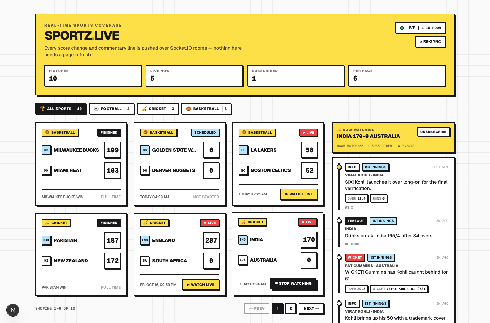

# Sportz — Real-Time Live Sports Platform

A full-stack, real-time live sports dashboard: instant score changes, match status
transitions and play-by-play commentary pushed over Socket.IO rooms, with no page
refreshes anywhere.

Translated from the legacy Express + `ws` + Drizzle two-repo setup into a single,
type-safe **Next.js 16 (App Router) + Socket.IO + Prisma/PostgreSQL** application.



---

## Stack

| Concern | Choice |
| --- | --- |
| Framework | Next.js 16 (App Router, React 19, TypeScript 5) |
| Realtime | Socket.IO 4 with native room management |
| Database | PostgreSQL 14+ via Prisma ORM 6 |
| Validation | Zod, shared between REST handlers and socket payloads |
| Server | Custom `server.mjs` — Next.js + Socket.IO on one port |
| Styling | Tailwind CSS v4 with a neo-brutalist token system |
| Testing | Vitest (unit + integration) and Playwright (E2E) |

---

## Quick start

```bash
# 1. Install dependencies (also runs `prisma generate`)
npm install

# 2. Start the workspace-local PostgreSQL cluster (data dir ./.pgdata, port 5433)
npm run db:start

# 3. Create the schema and the database
createdb -h 127.0.0.1 -p 5433 -U postgres sportz   # once
npm run db:migrate

# 4. Configure the environment
cp .env.example .env    # DATABASE_URL is pre-filled for the local cluster

# 5. Run the unified server (Next.js + Socket.IO)
npm run dev             # http://127.0.0.1:3000

# 6. In a second terminal: stream live matches into the dashboard
npm run seed            # add --speed 4 to go faster, --once for instant
```

Open <http://127.0.0.1:3000>, click **Watch live** on a fixture, and watch scores
and commentary arrive in real time.

> Prefer Docker for the database? See the alternatives in `.env.example`.

---

## How it works

### One port, three responsibilities

`server.mjs` is the single entry point. It mounts Socket.IO onto the same HTTP
server that Next.js uses, so there is no second process, no CORS surface and no
proxy:

```
client ──HTTP──▶  server.mjs ──▶ Next.js App Router (UI + /api/*)
       ──WS────▶       └───────▶ Socket.IO  (/socket.io)
```

Route Handlers reach the Socket.IO instance through `lib/socket-server.ts`, which
reads a `globalThis` slot the server populates. Broadcasting is always
best-effort: the database write happens first, so a client that misses an event
recovers on its next fetch.

### The three-phase match lifecycle

Status is **derived** from the fixture's time window (`startTime`/`endTime`),
never trusted from the stored column:

```
scheduled ──(now >= startTime)──▶ live ──(now >= endTime)──▶ finished
```

`lib/match-status.ts` is the source of truth, and `server.mjs` mirrors it because
plain Node ESM cannot import TypeScript. `npm run check:contract` fails the build
if the two ever disagree — along with the socket event names and room naming.

A background sweeper in `server.mjs` reconciles drifted rows every 10s, emits
`match:status`, and drops the room when a fixture finishes so idle clients stop
receiving traffic.

### Room-based fan-out

Every fixture has a room named `match:{id}`.

| Direction | Event | Payload | Broadcast to |
| --- | --- | --- | --- |
| client → server | `join:match` | `{ matchId }` | — |
| client → server | `leave:match` | `{ matchId }` | — |
| server → client | `match:created` | `Match` | all clients |
| server → client | `match:score` | `{ matchId, homeScore, awayScore }` | `match:{id}` |
| server → client | `match:commentary` | `Commentary` | `match:{id}` |
| server → client | `match:status` | `{ matchId, status, ... }` | all clients |
| server → client | `subscription:ack` | `{ matchId, room, joined, subscribers }` | the caller |
| server → client | `rate:limited` | `{ event, message, retryAfterMs }` | the caller |

`lib/types.ts` owns this contract; `scripts/check-contract.mjs` verifies
`server.mjs` still matches it.

### Client data flow

`hooks/useSocket.ts` owns the transport; `hooks/useMatchData.ts` is the only place
REST state and realtime state meet:

- **REST** is authoritative for *what exists* (initial SSR snapshot, manual
  re-sync, reconnection re-sync).
- **Sockets** are authoritative for *what just changed*, and are always *merged*
  rather than treated as a complete snapshot.
- A reconnect re-joins the fixture room and re-reads the snapshot, because
  broadcasts sent while the transport was down were missed.

The page is a Server Component that renders the first paint from PostgreSQL, then
hands off to the Client Component — so the grid is never empty while the socket
handshakes.

---

## API

All responses use one envelope: `{ "data": ... }` on success,
`{ "error": { code, message, issues? } }` on failure.

| Method | Route | Notes |
| --- | --- | --- |
| `GET` | `/api/matches` | `?limit=` (default 50, max 100), `?status=` filter. Newest first; statuses derived |
| `POST` | `/api/matches` | Zod-validated; `endTime` must follow `startTime`; emits `match:created` |
| `GET` | `/api/matches/[id]` | Single fixture with derived status |
| `PATCH` | `/api/matches/[id]/score` | Live fixtures only; scores may not decrease; emits `match:score` |
| `GET` | `/api/matches/[id]/commentary` | `?limit=` (default 50, max 100), newest first |
| `POST` | `/api/matches/[id]/commentary` | Unique `(matchId, sequence)`; duplicate sequences return `409` |
| `GET` | `/healthz` | Liveness + socket/room counts (answered before Next.js) |

Mutation endpoints are rate limited (match creation 60/min, score 240/min,
commentary 600/min by default). Socket rooms are additionally protected by a
per-connection token bucket, a per-IP connection cap, a 16 KB frame limit, and
payload validation on every event.

---

## Simulation engine

`scripts/seed.mjs` creates every fixture from `data/fixtures.ts` — football,
cricket and basketball profiles with sport-accurate vocabulary — and streams
their play-by-play at realistic intervals. It talks to the app through the public
API only, so it validates the same contract a browser does.

```bash
npm run seed                          # realtime pacing (~1.3s per event)
npm run seed -- --speed 4             # four times faster
npm run seed -- --once                # create fixtures, no streaming
npm run seed -- --sport basketball    # one sport
npm run seed -- --no-reset            # append instead of wiping
```

---

## Testing

The suite has three layers and 297 automated checks.

```bash
npm run typecheck        # next typegen + tsc --noEmit
npm run lint             # eslint
npm run check:contract   # server.mjs <-> lib/ drift guard
npm test                 # Vitest: 278 unit + integration tests
npm run test:e2e         # Playwright: 19 browser tests
npm run test:coverage    # coverage report with enforced thresholds
npm run verify           # typecheck + lint + contract + unit/integration
```

| Layer | What it covers |
| --- | --- |
| `tests/unit/lib` | Validation schemas, lifecycle derivation, serialisers, formatting, HTTP envelope and rate limiter |
| `tests/unit/hooks` | `useMatchData` (REST↔realtime merge, pagination, subscription lifecycle), `useSocket` (connect/reconnect/teardown), `useToast` |
| `tests/unit/components` | `MatchCard` (score pulse), `LiveFeed` (badges, metadata, empty/loading states), `Dashboard`, `Pagination`, `StatusIndicator`, `ToastStack` |
| `tests/integration/api` | All four route handlers against a real PostgreSQL database, including room-scoped broadcasts, status healing, unique-constraint conflicts and rate limiting |
| `tests/e2e` | Real browser: rendering, filters, tune-in, score/commentary over Socket.IO with no reload, room isolation between two clients, reconnect re-sync, cold reload |

Notes:

- Integration tests run against a dedicated `sportz_test` database (created and
  migrated automatically). The name *must* end in `_test` — the setup refuses to
  touch anything else.
- Browser tests use your installed Google Chrome by default (`channel: "chrome"`).
  Set `E2E_BROWSER_CHANNEL=""` and run `npm run test:e2e:install` to use the
  bundled Chromium instead.
- `npm run verify:realtime` runs an additional Socket.IO protocol probe
  (malformed payloads, isolation, unsubscribe, flooding) against a running server.

---

## Project layout

```
app/
  api/matches/          Route Handlers (list/create, get, score, commentary)
  page.tsx              Server Component: renders the first paint, suspends the rest
  layout.tsx globals.css
components/             Dashboard, MatchCard, LiveFeed, Pagination, StatusIndicator, ToastStack, Skeletons
hooks/                  useSocket, useMatchData, useToast
lib/                    env, prisma, queries, serializers, validations, types, http, socket-server, format
data/fixtures.ts        Multi-sport fixture profiles + scripted play-by-play
prisma/                 schema.prisma + committed SQL migration
scripts/                seed.mjs, verify-realtime.mjs, check-contract.mjs, playwright.sh
tests/                  unit, integration, e2e, setup
server.mjs              Custom server: Next.js + Socket.IO on one port
```

Two deliberate notes on structure:

- `server.mjs` is plain ESM and bypasses the Next.js compiler (as Next's own
  custom-server guide states). It therefore mirrors a few constants from `lib/`,
  which `npm run check:contract` keeps honest.
- `data/` and `scripts/` are outside `app/` on purpose: they are not routes, and
  `app/` should contain routing files only.

---

## Available scripts

| Script | Purpose |
| --- | --- |
| `npm run dev` / `build` / `start` | Unified Next.js + Socket.IO server |
| `npm run db:start` / `db:stop` / `db:status` | Workspace-local PostgreSQL cluster |
| `npm run db:migrate` / `db:push` / `db:generate` / `db:studio` | Prisma workflows |
| `npm run seed` | Simulation engine |
| `npm test` / `test:watch` / `test:coverage` / `test:e2e` | Test suites |
| `npm run verify` | Full pre-commit gate |

---

## Troubleshooting

**`Cannot reach the Sportz server`** — the simulator needs the app running. Start
`npm run dev` first, or pass `--url`.

**PostgreSQL will not start** — the workspace-local cluster needs `initdb` once:
`initdb -D ./.pgdata -U postgres --auth=trust`. Alternatively point `DATABASE_URL`
at any PostgreSQL instance (Docker example in `.env.example`).

**The connection pill stays on "Connecting"** — in development, Next.js blocks
cross-origin requests for its own assets. `next.config.ts` whitelists
`127.0.0.1`/`localhost` through `allowedDevOrigins`; add any other host you use
(for example a tunnel domain) to that list.

**Scores update but commentary does not** — the client only receives commentary
for the fixture it is tuned into. Click **Watch live** to join that room.
